# Data Model: Masjid Directory, Verification and Schedules (Phase 1)

**Date**: 2026-10-22 | **Spec**: [spec.md](spec.md) | **Research**: [research.md](research.md) | **State machines**: [contracts/state-machines.md](contracts/state-machines.md)

Server side only. The listener app stores nothing here (FR-003); its local tables are in research R-30. Style follows Phase 0: plain tables, short rationale lines. Where research.md and a research report disagree, research.md wins; leftovers are in "Issues found".

## Conventions

- PostgreSQL 18 + PostGIS 3.6, `pg_trgm`, `pgcrypto`. Migrations are plain forward-only `NNNN_name.sql` applied by Kysely; no down scripts (expand, then contract).
- Primary key `id uuid DEFAULT uuidv7()` unless stated. `masjid.id` is text (`m` + 7 random base32 chars, R-26). Every table has `created_at timestamptz NOT NULL DEFAULT now()`; mutable tables also `updated_at` (trigger). Only exceptions are listed.
- Enums are `text` + `CHECK` (adding a value is one forward migration). Times are `timestamptz` (UTC). No listener identifier of any kind exists in any table (P4, FR-003).
- Columns ending `_ref` hold `actor_ref` (random pseudonym, `actor_map`), never `account.id`, so account deletion never rewrites history. Tables that die with the account (`masjid_member`, `credential`, `auth_event`) use `account_id`.
- Status changes go through one domain function per machine: compare-and-set `UPDATE ... WHERE status = $from`, then a trigger checks `(from, app.event, to)` against `state_transition` (seeded from `services/domain`). Time-based states are columns (`verified_until`, `reminder_sent_at`, `delete_after`, `not_before`, ...); pg-boss sweepers are idempotent and write nothing the database cannot rebuild (R-04).
- Valkey (not modelled): sessions `sess:{sha256(id)}`, per-account session set, TOTP step markers, rate-limit counters (HMAC of address with daily salt, TTL at most 24 h). Mirrored in PostgreSQL only: `credential.session_epoch`, `mfa_factor.last_used_step`.
- pg-boss owns its `pgboss` schema (created at deploy by the owner role; included in backups).

### Layer legend (R-27)

| Tag | Layer | Licence | Published to |
|-----|-------|---------|--------------|
| **B** | BASE: OSM-derived and curated facts (names, location, address, kind, denomination, wikidata, `sx`), plus Operator and admin overrides of name, location, address | ODbL | `base` files per 5 km cell, `country` and `g4` summaries, `redirects.json`, open dump |
| **O** | OVERLAY, published subset: status badge `st` (V/P), `vu` verified_until, madhhab, calculation method, Azaan variant, schedule revision `sr`; schedule rules | project terms | `overlay` files per cell; schedule RULE bundles per precision-4 area (`sched`) |
| **O\*** | OVERLAY, never published: contacts, photos, facilities, languages, version history | project terms | no file; authenticated console API only |
| **P** | PRIVATE: claims, evidence, committee contacts, accounts, audit, jobs, bookkeeping | none | never |

Rule: a column in a published file must be tagged B or O. Pending, Unclaimed, Suspended and Revoked Masjids publish base fields only (plus `st` for Pending); Verified adds madhhab, method, variant, `vu`, `sr` and rules (FR-019).

## 1. Entity map

```mermaid
erDiagram
  masjid ||--o{ masjid_osm_ref : "has"
  masjid ||--o{ masjid_translation : "names"
  masjid ||--o| masjid_profile : "overlay"
  masjid ||--o{ masjid_public_contact : ""
  masjid ||--o{ masjid_photo : ""
  masjid ||--o| schedule : "current"
  masjid ||--o{ masjid_version : "history"
  schedule ||--o{ schedule_version : "history"
  masjid ||--o| curated_entry : ""
  masjid ||--o{ claim : ""
  claim ||--o{ decision : ""
  decision ||--o| appeal : "at most one"
  claim ||--o{ evidence_file : ""
  claim ||--o{ committee_contact : ""
  claim ||--o{ verification_call : ""
  claim_conflict ||--|{ claim_conflict_member : ""
  claim ||--o{ claim_conflict_member : ""
  masjid ||--o{ masjid_member : ""
  account ||--o{ masjid_member : ""
  masjid ||--o{ invitation : ""
  masjid ||--o{ ownership_transfer : ""
  account ||--|| credential : ""
  account ||--o{ mfa_factor : ""
  account ||--o{ recovery_code : ""
  account ||--|| actor_map : "pseudonym"
  account ||--o| operator : ""
  operator ||--o{ operator_role : ""
  account ||--o{ recovery_case : "subject"
  account ||--o{ reset_token : ""
  account ||--o{ auth_event : ""
  osm_import_batch ||--o{ osm_staging : ""
  masjid ||--o{ duplicate_candidate : "a,b"
  masjid ||--o{ masjid_merge : "loser,winner"
  pack_build ||--o{ pack_file : ""
  masjid ||--o{ abuse_report : ""
  masjid ||--o{ suggestion : ""
  audit_log }o--|| actor_map : "actor_ref (deletable link)"
```

## 2. Directory: base layer and overlay

### `masjid` (one row per place; id never derived from OSM)
| Column | Type | Null | Constraint / default | Layer | Note |
|--------|------|------|----------------------|-------|------|
| id | text | no | PK; `CHECK (id ~ '^m[a-z2-7]{7}$')`; default `new_masjid_id()` (retry on clash) | B | e.g. `m4kx72ab` (8 characters); assigned once, never reused (R-26) |
| source | text | no | `IN ('osm','curated','claimed','suggested')` | B | FR-022, spec Key Entities |
| kind | text | no | `IN ('mosque','musalla')` default 'mosque' | B | R-26 filter |
| denomination, wikidata | text | yes | wikidata `~ '^Q[0-9]+$'` | B | OSM `denomination` is not madhhab |
| location | geometry(Point,4326) | no | `ST_IsValid`, lon/lat ranges | B | placed by OSM, curation or an Operator; never by a listener (FR-011) |
| geohash5 | text | no | `GENERATED ALWAYS AS (ST_GeoHash(location, 5)) STORED` | B | the cell id; pack key; never finer (FR-033) |
| country_code | char(2) | no | `~ '^[A-Z]{2}$'` | B | |
| addr_street, addr_city, addr_region, addr_postcode | text | yes | each at most 200 chars | B | from `addr:*` |
| sx | text | yes | | B | generated Latin search key (ICU transliteration + shared normaliser, R-30) |
| needs_review | bool | no | default false | B | `building=mosque` with no religion tag (R-26) |
| local_override | text[] | no | default '{}', subset of `{names,location,address}` | P | fields an Operator or admin changed; imports must not overwrite them |
| contrib_terms_version | text | yes | required when source IN ('suggested','claimed') | P | submission terms accepted (R-27: ODbL-compatible grant) |
| time_zone | text | yes | IANA id; required before a schedule exists | O | published inside rule records |
| listing_status | text | no | `IN ('unclaimed','pending','verified','suspended','revoked')` default 'unclaimed' | O | machine in state-machines.md section 2 |
| status_reason_code, status_changed_at | text, timestamptz | yes | | P | |
| verified_claim_id | uuid | yes | FK `claim` (added in 0006) | P | basis of the current Verified status |
| verified_at, verified_until, grace_until | timestamptz | yes | `verified_until = verified_at + 12 months`, `grace_until = verified_until + 30 days` (set by the domain function; `timestamptz + interval` is not immutable, so not generated) | P (`vu` is O) | FR-017 |
| reminder_sent_at, expiry_notice_sent_at, lapse_notice_sent_at | timestamptz | yes | | P | idempotency flags for the three yearly mails (T-30, T, T+30) |
| published_at | timestamptz | yes | null = never in any file | P | a `claimed` Masjid becomes public only when verified; imports and curated are public at creation |
| retired_at, retired_reason | timestamptz, text | yes | `IN ('merged','vanished','operator_removed')` | P | hidden from base files; emits a tombstone or redirect |
| merged_into | text | yes | FK `masjid`; flattened (never a chain) | B | redirect target (R-26) |
| version_no | int | no | default 1 | P | optimistic lock for profile edits (FR-019) |

### `masjid_osm_ref` (many OSM objects may point to one Masjid)
| Column | Type | Null | Constraint / default | Layer | Note |
|--------|------|------|----------------------|-------|------|
| osm_type, osm_id | text, bigint | no | PK together; type `IN ('node','way','relation')` | B | |
| masjid_id | text | no | FK `masjid` | B | |
| first_seen, last_seen | timestamptz | no | | P | import replication timestamps |
| status | text | no | `IN ('present','vanished','tombstoned')` | P | |
| missed_imports | smallint | no | default 0 | P | 2 consecutive misses on an unclaimed Masjid retire it with a tombstone; claimed or verified Masjids get an `operator_task` instead and stay visible |

### `masjid_translation` (names, FR-030)
| Column | Type | Null | Constraint / default | Layer | Note |
|--------|------|------|----------------------|-------|------|
| masjid_id | text | no | FK, ON DELETE CASCADE | B | |
| lang | text | no | BCP 47 regex; `UNIQUE (masjid_id, lang, name_role)` | B | `ar` Arabic script, `ar-Latn` transliteration, `ur`, `id`, local language tag; transliteration is the `-Latn` script subtag |
| name_role | text | no | `IN ('name','alt','official','old','int')` default 'name' | B | `old` is search only, never displayed |
| name | text | no | 1 to 200 chars | B | |
| name_norm | text | no | `GENERATED ALWAYS AS (app.normalize_name(name)) STORED` | B | IMMUTABLE SQL function; same rules as the client normaliser (R-30); trigram search in the console |
| is_primary | bool | no | default false | B | exactly one per Masjid (below) |
| origin | text | no | `IN ('osm','curated','operator','admin','suggested')` | B | the open dump filters on it (FR-031) |

Exactly one primary name (DB constraint): partial unique index `(masjid_id) WHERE is_primary` plus a `DEFERRABLE INITIALLY DEFERRED` constraint trigger that requires `count(*) = 1` among `name_role = 'name'` at commit. Unnamed OSM Masjids (12 to 54%) get a generated label on the phone, not a row.

### Overlay (`O` published fields, `O*` never published)
| Table.column | Type | Null | Constraint | Layer | Note |
|--------------|------|------|------------|-------|------|
| masjid_profile.masjid_id | text | no | PK, FK | O* | 1:1 current values; history in `masjid_version` |
| masjid_profile.madhhab | text | yes | `IN ('hanafi','maliki','shafii','hanbali','jafari','other')` | O | separate from OSM `denomination` |
| masjid_profile.calc_settings | jsonb | yes | validated against `{method, asr, high_latitude_rule, offsets, imsak_minutes, rounding}` by `masjid_schedule`: `method` is one of the 14 Phase 0 method ids; `asr IN ('standard','hanafi')`; `high_latitude_rule IN ('middleOfNight','seventhOfNight','angleBased')`; `offsets` = per-prayer integer minutes in -60..60 for fajr, sunrise, dhuhr, asr, maghrib, isha; `imsak_minutes` 0..60; `rounding IN ('none','nearest5','up5')` default 'none' | O | the settings the phone needs to expand `calc` times in `masjid-schedule/1` (contracts/schedule-rules.md); the schedule's own `calc` block must equal it (warning, FR-020); published as `cm`, `as`, `hl`, `of` only; `imsak_minutes` and `rounding` stay console-side (rule records carry `roundTo`) |
| masjid_profile.azaan_variant | text | yes | `IN ('standard','shia')` | O | Phase 0 variants |
| masjid_profile.languages, facilities | text[] | no | default '{}'; BCP 47 / controlled vocabulary | O* | |
| masjid_public_contact (id, masjid_id, kind, value, label, sort_order) | | | kind `IN ('phone','email','website')`; website must be `https`; at most 6 per Masjid | O* | never in a file (R-27); console only |
| masjid_photo (id, masjid_id, sha256, storage_name, width, height, bytes, alt_text, sort_order, removed_at) | | | alt_text NOT NULL (FR-007); at most 10; WebP re-encoded, metadata dropped, at most 1 MB | O* | never in a file (R-27) |
| curated_entry (masjid_id PK, list_key, rank, sources jsonb, verified_by_ref, verified_at) | | | `list_key IN ('two_holy_mosques','major')`; `sources` = array of at least 1 `{url, retrieved, licence}`, licence from an allow-list (CC0, ODbL, public domain; no share-alike text) | B | US6.4; feeds `country` and `g4` files |

### `schedule` (current rules) and versions
| Column | Type | Null | Constraint / default | Layer | Note |
|--------|------|------|----------------------|-------|------|
| masjid_id | text | no | PK, FK | O | one schedule per Masjid |
| schema_id | text | no | `= 'masjid-schedule/1'` | O | r6 section 4; JSON Schema in contracts/schedule-rules.md |
| time_zone | text | no | IANA; equals `masjid.time_zone` | O | rules are interpreted in this zone, not the phone's (FR-013) |
| rules | jsonb | no | validated by `masjid_schedule` (Dart compiled to JS) before save; at most 64 KB | O | `ranges[]` (MM-DD or YYYY-MM-DD, no overlap or gap), per prayer `azaan` fixed or calc+offsetMin, `iqamah` fixed, afterAzaanMin or calc+offsetMin; `jumuah[]` ranges with `shifts[]`; `calc` settings |
| revision | int | no | default 1, bumped on every save | O | published as `sr` and in the bundle record |
| rules_sha256 | bytea | no | | O | ETag input |
| tzdata_version | text | no | | O | version used at validation (R-06) |
| version_no | int | no | optimistic lock | P | |

| Table | Columns | Rules |
|-------|---------|-------|
| `masjid_version` (O\*) | id, masjid_id, version_no, parent_version_id, snapshot jsonb (base overrides, translations, profile, contacts, photo list), change_kind `IN ('import','edit','operator','rollback','merge','suggestion')`, restored_from_version_no, author_ref, terms_version, note (500) | append-only; `UNIQUE (masjid_id, version_no)`; rollback inserts a NEW version that copies an older snapshot (`restored_from_version_no` required); first row has null parent |
| `schedule_version` (O\*) | same shape; snapshot = full `schedule` row content; `rules_sha256` | same rules; separate history from the profile |

Optimistic locking (FR-019): the writer sends `expected_version_no`; the transaction does `UPDATE masjid SET version_no = version_no + 1 ... WHERE id = $1 AND version_no = $2`; zero rows returns 409 `version_conflict` and writes nothing (no audit row, no version row). Same for `schedule` and for a rollback racing an edit. `masjid_version` and `schedule_version` have `REVOKE UPDATE, DELETE` except a SECURITY DEFINER `redact_version()` used for privacy erasure (audited).

## 3. OSM import, duplicates, merges, packs

| Table.column | Type | Null | Constraint / default | Layer | Note |
|--------------|------|------|----------------------|-------|------|
| osm_import_batch.id, country_code, extract_ref | | no | extract e.g. a Geofabrik file name | P | R-26 |
| osm_import_batch.replication_ts, started_at, finished_at | timestamptz | yes | | P | recorded per generation |
| osm_import_batch.status | text | no | `IN ('staging','review','approved','applied','rolled_back','rejected','failed')` | P | review: moderator or super-admin; publish and rollback: super-admin only |
| osm_import_batch.counts, attribution_version | jsonb, text | no | counts `{new,changed,vanished,unchanged}` | P | FR-023 |
| osm_import_batch.approved_by_ref, approved_at | | yes | | P | |
| osm_staging.(batch_id, osm_type, osm_id) | | no | PK | P | |
| osm_staging.tags | jsonb | no | keys only from the allowlist: `name`, `name:ar`, `name:en`, `name:ur`, country-language name, `int_name`, `alt_name`, `official_name`, `old_name`, `addr:*`, `denomination`, `place_of_worship`, `wikidata` (CHECK `app.tags_allowed(tags)`) | P | dropped before insert: phone, contact:*, email, website, operator, note, fixme, source* (personal data) |
| osm_staging.kind, sx, needs_review | text, text, bool | | as `masjid` | P | |
| osm_staging.location | geometry(Point,4326) | no | | P | |
| osm_staging.match_kind | text | no | `IN ('exact_ref','near_name','inside_outline','new','vanished')` | P | near: within 50 m and name similarity at least 0.6 |
| osm_staging.matched_masjid_id, diff jsonb, checks jsonb | | yes | checks = country bbox, name length, URL schemes stripped, HTML escaped | P | diff vs previous before approval |
| osm_staging.decision | text | no | `IN ('pending','accept','skip')` default 'pending' | P | |
| duplicate_candidate (id, masjid_a, masjid_b, level, name_similarity real, distance_m real, status, decided_by_ref, decided_at, reason_code) | | | `masjid_a < masjid_b`; `UNIQUE (masjid_a, masjid_b)`; level `IN ('high','medium')`: high = within 30 m and (shared normalised name, node inside outline, or one side unnamed), medium = within 150 m and `similarity()` at least 0.35; status `IN ('open','merged','not_duplicate','deferred')` | P | never auto-merged (FR-022) |
| masjid_merge (id, winner_id, loser_id, candidate_id, merged_by_ref, merged_at, fields_taken jsonb, reason_code) | | | loser must be Unclaimed with no open claim, no members | B (id pair) | feeds `redirects.json` (ids only, kept at least 12 months; this table keeps them) |
| pack_build (id, gen int, layer, started_at, finished_at, status, input_digest, osm_replication_ts) | | | layer `IN ('base','overlay','sched','country','g4','dump')`; status `IN ('running','ok','failed')` | P | one row per generation per layer |
| pack_file (id, build_id, layer, key, part int, parts int, cv text, gen int, bytes_uncompressed int, size_class int, built_at, path, superseded_at, delete_after) | | | key = gh5 for base and overlay, gh4 for sched and g4, ISO2 for country; `bytes_uncompressed <= 500000`; `part BETWEEN 1 AND parts`; parts split by `hash(id) mod N`, `N = ceil(bytes/400000)`; one current row per `(layer, key, part)` | P | the manifest is regenerated from these rows; no signature column (not in Phase 1); old versions kept at least 30 days |
| pack_dirty_cell (layer, key, marked_at) | | | PK `(layer, key)` | P | rebuildable; a base change marks the cell and its 8 neighbours (5 km buffer); an overlay change marks the cell and its `gh4` sched area |

## 4. Accounts, credentials, recovery (all layer P)

| Table.column | Type | Null | Constraint / default | Note |
|--------------|------|------|----------------------|------|
| account.email | text | no | at most 254; `UNIQUE (lower(email))` | deleted with the account |
| account.kind | text | no | `IN ('admin','muazzin','operator')` | one kind per account; memberships carry per-Masjid role (an admin may be a Muazzin elsewhere) |
| account.status | text | no | `IN ('pending_mfa','active','locked','disabled')` | machine in state-machines.md section 4d |
| account.email_verified_at, locked_at, disabled_at, disabled_reason_code, locale | | yes | | |
| credential.account_id | uuid | no | PK, FK CASCADE | |
| credential.password_hash | text | no | `LIKE '$argon2id$%'` | m=64 MiB, t=3, p=1 (R-09) |
| credential.session_epoch | bigint | no | default 0 | bumped on reset, break-glass, suspension; stale Valkey sessions die |
| credential.password_changed_at, force_password_reset | | | | |
| mfa_factor (id, account_id, kind 'totp', secret_enc bytea, key_id smallint, last_used_step bigint, activated_at) | | | secret AES-256-GCM (AAD = account id); one active per account (partial unique) | enrolment active only after a valid code |
| recovery_code (id, account_id, code_hash text, used_at) | | | 10 per set, argon2id; regenerate deletes the old set | |
| actor_map (actor_ref uuid PK `gen_random_uuid()`, account_id uuid UNIQUE FK CASCADE, delete_after) | | | random v4 on purpose (no time leak) | the only link from audit to a person; row deleted on account deletion; Operators: `delete_after = offboarded_at + 24 months` (proposal) |
| auth_event (id bigint, ts, account_id FK CASCADE, event, outcome, ip inet, ip_truncated bool, ua_family text) | | | event `IN ('login_ok','login_failed','mfa_failed','recovery_used','lockout','session_terminated')`; raw ip 30 days, then `ip_truncated` (/24 or /48), row deleted at 12 months | R-17 |
| reset_token (id, account_id FK CASCADE, token_hash bytea UNIQUE, state, expires_at, flow_expires_at, attempts smallint) | | | SHA-256 of a 256-bit token; link valid 10 min, then 10 min to finish after the link is opened; state per state-machines.md 4a | single use; a newer request voids older |
| recovery_case (id, kind, account_id, masjid_id, state, initiator_ref, assigned_to_ref, recovery_code_consumed_at, call_id, approved_by_ref, second_approved_by_ref, approved_at, not_before, cancelled_by_ref, cancel_reason, expires_at, executed_at) | | | kind `IN ('mfa_reset','break_glass','operator_recovery')` (operator_recovery = an Operator's own lockout: a different super-admin initiates, a second Operator co-signs); constraint `recovery_case_approver_not_initiator`: `CHECK (approved_by_ref IS DISTINCT FROM initiator_ref)`; `recovery_case_second_distinct` for the second approver (Operator lockouts); `recovery_case_not_before_48h`: break-glass `not_before = approved_at + interval '48 hours'`; `recovery_case_mfa_needs_code`: an `mfa_reset` cannot reach `approved` unless `recovery_code_consumed_at IS NOT NULL`; `recovery_case_bg_needs_call`: a `break_glass` (not `operator_recovery`) cannot reach `call_verified` or later without `call_id`; `(kind,state)` pairs checked | FR-026; mfa_reset has no delay; break-glass initiator must be super-admin and approver at least reviewer (policy table, plus the CHECK) |
| recovery_case roles | | | break-glass: initiator and `log_call` are super-admin only; the approver is a reviewer or super-admin, never a moderator and never the initiator; `operator_recovery` adds a second approver of the same kind | | policy table plus the CHECKs above |
| recovery_case notification flags: notified_admin_at, notified_contacts_at, reminder_24h_at, reminder_1h_at, executed_notice_at, cancel_token_hash | timestamptz, bytea | yes | | "notifications sent" flags survive restarts; contacts get a cancel link |
| operator (account_id PK, display_name, onboarding_ack_at, offboarded_at, offboarded_by_ref, offboarding jsonb) | | | `onboarding_ack_at` required before a case can be assigned (FR-028); offboarding = sessions revoked, cases reassigned, KEK rotation needed, access removed | |
| operator_role (id, account_id, role, granted_by_ref, granted_at, revoked_at, revoked_by_ref) | | | `role IN ('reviewer','moderator','super_admin')`; one active row per (account, role); trigger: granter is super-admin and not the grantee | roles union |
| terms_acceptance (account_id, document, version, accepted_at) | | | PK all; document `IN ('admin_terms','privacy_notice','operator_conduct')` | proves the licence grant for base-field edits |

## 5. Claims, verification, evidence

| Table.column | Type | Null | Constraint / default | Layer | Note |
|--------------|------|------|----------------------|-------|------|
| claim.masjid_id | text | no | FK | P | kind `create` references a hidden new Masjid (`published_at` null) |
| claim.kind | text | no | `IN ('claim','create','renewal')` | P | |
| claim.claimant_ref, assigned_to_ref | uuid | no / yes | actor_refs | P | |
| claim.status | text | no | 14 values stored snake_case (`in_review`, `needs_info`, `rejected_final`, ...; state-machines.md section 1 writes them CamelCase) | P | one open claim per claimant per Masjid (partial unique) |
| claim.second_review_required | bool | no | default false; forced true when the listing is Revoked | P | runbook 4.1 step 8 |
| claim.submitted_at, decided_at, final_at | timestamptz | yes | | P | |
| claim.draft_expires_at, needs_info_due_at, appeal_deadline | timestamptz | yes | draft +30 days idle, needs-info +30 days, appeal = decision + 30 days | P | timers are columns |
| claim.superseded_by_claim_id, conflict_id | uuid | yes | | P | |
| claim.row_version | int | no | | P | |
| state_transition (machine, from_state, event, to_state) | text x4 | no | PK all four | P | seeded from the one TypeScript table; trigger rejects pairs not in it |
| decision (id, claim_id, masjid_id, subject_kind, kind, reason_code, reason_text, decided_by_ref, decided_at, call_id, appeal_deadline) | | | subject_kind `IN ('claim','listing')`; kind covers verify, reject, request_info, revoke, suspend, lift, appeal_*, arbitration; reason_code required; text at most 2000 chars, no names or numbers (runbook 3.2); append-only | P | what the admin reads |
| appeal (id, decision_id UNIQUE, filed_by_ref, statement, origin_state, status, decided_by_ref, decided_at, outcome_reason) | | | status `IN ('open','upheld','dismissed','withdrawn')`; `UNIQUE (decision_id)` is the "exactly one appeal per decision" rule; trigger: decider differs from the decision's decider | P | FR-016 |
| claim_conflict (id, masjid_id, state, freeze_incumbent bool, arbitrator_ref, winner_claim_id, resolved_at, reason_code) | | | state `IN ('open','resolved','dissolved')`; one open per Masjid (partial unique) | P | FR-018 |
| claim_conflict_member (conflict_id, claim_id PK, role `IN ('incumbent','challenger')`) | | | | P | |
| verification_call (id, claim_id, recovery_case_id, transfer_id, operator_ref, contact_id, called_at, outcome, script_version, note, delete_after) | | | exactly one of the three subject ids; outcome `IN ('C1'..'C7')` per runbook section 5; note at most 1000 chars, no numbers | P | FR-017: a human call, no paid telephony |
| case_note (id, subject_kind, subject_id, author_ref, body, delete_after) | | | body at most 4000 chars | P | US5.1; deleted with the evidence for claims |

### Evidence and contacts (FR-008, FR-032; R-13)
| Table.column | Type | Null | Constraint / default | Layer | Note |
|--------------|------|------|----------------------|-------|------|
| evidence_file.claim_id | uuid | no | FK | P | |
| evidence_file.kind | text | no | `IN ('committee_doc','authorization_letter','building_photo','other')` | P | |
| evidence_file.source_group, page_no | uuid, int | yes | a PDF becomes one row per rasterised page (at most 10) | P | |
| evidence_file.storage_name | uuid | no | UNIQUE; disk name `/var/lib/deen-evidence/<uuid>.bin` | P | original filename never stored |
| evidence_file.label, bytes, width, height | | | label at most 60 chars `[A-Za-z0-9 ._-]` | P | |
| evidence_file.wrapped_dek | bytea | yes | per-file key wrapped by the KEK; null after purge; column `SELECT` revoked from the app role | P | crypto-shred |
| evidence_file.kek_id | smallint | no | | P | rotation re-wraps only |
| evidence_file.ciphertext_sha256 | bytea | no | | P | |
| evidence_file.delete_after | timestamptz | yes | final decision + 90 days; null while the claim is open | P | |
| evidence_file.hold_reason | text | yes | `IN ('appeal')` only | P | blocks the sweeper |
| evidence_file.purged_at, purge_reason | | yes | `IN ('retention','early_request','withdrawn','account_deletion')`; `purged_at IS NOT NULL` implies `wrapped_dek IS NULL` | P | |
| evidence_fingerprint (id, masjid_id, bundle_fp bytea, image_fps bytea[], pepper_id smallint, decision_id, delete_after) | | | HMAC-SHA256 of sanitised images; `UNIQUE (masjid_id, bundle_fp)`; `delete_after = rejection + 12 months`; written only for merit rejections (not no-response, not lost arbitration); nothing else kept | P | FR-016 identical evidence |
| committee_contact (id, claim_id, recovery_case_id, role_label, payload_enc bytea, wrapped_dek, kek_id, delete_after, purged_at) | | | exactly one of the two case ids; name, phone, email only inside `payload_enc`; at least 2 per submitted claim; RLS: readable only through `read_committee_contact()` by the assigned Operator (or, for a Conflicted claim, the arbitrator of its open conflict) while the case is open; each read audited | P | FR-032; own table |

## 6. Membership, invitations, transfers (all P)

| Table.column | Type | Constraint / default | Note |
|--------------|------|----------------------|------|
| masjid_member (masjid_id, account_id, role, source, added_by_ref) | PK (masjid_id, account_id); role `IN ('admin','muazzin')`; source `IN ('claim','invitation','transfer')` | current rows only; history is the audit; revoke deletes admin rows |
| invitation (id, masjid_id, kind, invitee_email, token_hash UNIQUE, state, invited_by_ref, expires_at, terminal_at) | kind `IN ('muazzin','co_admin')`; state `IN ('pending','accepted','declined','expired','revoked')`; `expires_at = created_at + 7 days`; at most one pending per (masjid, lower(email), kind); `invitee_email` nulled at terminal state | the accepting account's email must match |
| ownership_transfer (id, masjid_id, kind, requested_by_ref, incoming_account_id, incoming_email, target_account_id, state, approved_by_ref, decision_reason_code, expires_at, terminal_at) | kind `IN ('transfer','remove_admin')`; state per state-machines.md 5e; `CHECK (approved_by_ref IS DISTINCT FROM requested_by_ref)`; `expires_at = created_at + 14 days` | FR-018; Operator approval and a logged call required |

## 7. Operations: mail, tasks, privacy, public writes (all P)

| Table.column | Type | Constraint / default | Note |
|--------------|------|----------------------|------|
| email_outbox (id, dedupe_key UNIQUE, to_address, template, locale, payload_enc bytea, account_id, masjid_id, state, attempts, next_attempt_at, sent_at, bounce_code, purge_after) | state `IN ('queued','sent','soft_bounce','hard_bounce','failed','cancelled')`; `payload_enc` (links, tokens) wiped when sent or failed; `to_address` nulled at `purge_after = terminal + 30 days` | the T-30 reminder survives restarts; dedupe key e.g. `verif_reminder:<masjid>:<vu epoch>`; renewals capped at 60 per day (relay limit) |
| operator_task (id, kind, masjid_id, subject_id, status, due_at, assigned_to_ref, done_by_ref, note) | `recovery_request` comes from the public lockout request (state-machines.md 4e): `subject_id` = account id, nothing else stored; `fraud_flag` is filed by a reviewer who suspects fraud, for a moderator to act on; kind `IN ('bounced_address','hold_review','osm_vanished','orphaned_listing','reassign_case','recovery_request','fraud_flag','privacy_overdue')`; status `IN ('open','done','cancelled')` | bounced address (spec edge case): an Operator reaches the admin by another route; the admin changes the email in the console (step-up) |
| privacy_request (id, kind, subject_kind, account_id, requester_email, status, due_at, reminder_due_at, reminder_sent_at, identity_method, identity_verified_at, handler_ref, outcome_code, outcome_note, closed_at, export_name, export_expires_at) | kind `IN ('export','delete')`; `due_at = created_at + 30 days`, `reminder_due_at = created_at + 20 days` (CHECK); status per state-machines.md 5d | FR-024; account_id set null when the account is deleted |
| suggestion (id, kind, masjid_id, cell_id char(5), country_code, body, proposed_name, proposed_address, contact_email, terms_version, status, assigned_to_ref, resolution_code, closed_at, contact_delete_after, result_masjid_id) | PUBLIC write; cell_id `~ '^[0-9b-hjkmnp-z]{5}$'`; `body` at most 2000; `kind='new_masjid'` requires `masjid_id IS NULL`, `proposed_name`, `terms_version`; **no coordinates, no IP, no hash of an IP, no device data**; `contact_email` only if typed, `contact_delete_after = closed_at + 30 days` | an Operator places the pin on accept; accepted new Masjids enter BASE with `source='suggested'` (R-27) |
| abuse_report (id, kind, masjid_id, cell_id, country_code, body, contact_email, status, assigned_to_ref, outcome_code, duplicate_of_id, closed_at, contact_delete_after) | PUBLIC write; kind `IN ('wrong_info','fake_masjid','impersonation')`; same no-identifier rules | |

## 8. Audit (layer P)

| Table.column | Type | Null | Constraint / default | Note |
|--------------|------|------|----------------------|------|
| audit_log.id | bigint | no | `GENERATED ALWAYS AS IDENTITY` PK | |
| ts | timestamptz | no | `clock_timestamp()` | |
| actor_ref | uuid | yes | null = system or public | pseudonym; link deletable |
| actor_role | text | no | | role at the time of the action |
| action | text | no | `~ '^[a-z_]+(\.[a-z_]+)+$'` | one dotted namespace (catalogue in state-machines.md section 7) |
| object_type, object_id | text, text | no / yes | | `object_id` is text so it holds `masjid.id` or a uuid |
| masjid_id, case_id | text, uuid | yes | | filters and retention |
| audience | text | no | `IN ('admin','operator')` default 'operator' | fail closed; admins read only 'admin' rows of their Masjids |
| retention_class | text | no | `IN ('operational','evidence','history')` | |
| request_id | uuid | yes | | correlation id |
| detail | jsonb | no | whitelist per action: reason code, version no, changed field names, ids; no names, emails, evidence content, filenames, IPs | contact fields: names only, never values |
| prev_hash, row_hash | bytea | no | `row_hash = sha256(prev_hash || canonical_json(row))`, serialised by `pg_advisory_xact_lock` | tamper evidence |
| audit_anchor (id, kind, up_to_id, head_hash, anchored_at, anchor_ref) | | | kind `IN ('daily','retention_checkpoint')` | head hash copied off-server daily; checkpoint lets the chain verify after old rows are purged |

## 9. Keys and indexes

| Table | Index | Purpose |
|-------|-------|---------|
| masjid | `GiST (location)`; `GiST ((location::geography))`; `btree (geohash5)`; `btree (country_code)` | pack builds by cell, buffer queries, duplicate distance in metres |
| masjid | partial `(verified_until) WHERE listing_status = 'verified' AND reminder_sent_at IS NULL` | reminder sweep |
| masjid | partial `(grace_until) WHERE listing_status = 'verified'` | lapse sweep |
| masjid | partial `(merged_into) WHERE merged_into IS NOT NULL`; `(published_at) WHERE published_at IS NOT NULL`; trigram `GIN (addr_city gin_trgm_ops)` | redirects, builds, console search |
| masjid_osm_ref | PK `(osm_type, osm_id)`; `(masjid_id)`; partial `(status) WHERE status <> 'present'` | import match, vanish sweep |
| masjid_translation | `UNIQUE (masjid_id, lang, name_role)`; partial `UNIQUE (masjid_id) WHERE is_primary`; `GIN (name_norm gin_trgm_ops)` | one primary, duplicate detection, global search |
| claim | partial `UNIQUE (masjid_id, claimant_ref) WHERE status IN ('draft','submitted','in_review','needs_info','conflicted','appealed')`; partial `(assigned_to_ref, status) WHERE status IN ('submitted','in_review','needs_info','conflicted','appealed')` | one open claim; review queue |
| claim | partial `(needs_info_due_at) WHERE status = 'needs_info'`; `(appeal_deadline) WHERE status IN ('rejected','revoked')`; `(draft_expires_at) WHERE status = 'draft'` | timer sweeps |
| appeal, evidence_fingerprint | `UNIQUE (decision_id)`; `UNIQUE (masjid_id, bundle_fp)`; `(delete_after)` | one appeal; identical-evidence lookup; purge |
| evidence_file, committee_contact | partial `(delete_after) WHERE purged_at IS NULL AND hold_reason IS NULL AND delete_after IS NOT NULL`; `(claim_id)`; `UNIQUE (storage_name)` | retention sweep (`evidence_past_due` metric must be 0) |
| recovery_case | partial `(not_before) WHERE kind = 'break_glass' AND state = 'approved'`; partial `UNIQUE (account_id, kind) WHERE state IN ('requested','in_review','initiated','call_verified','approved')`; partial `(expires_at) WHERE state NOT IN terminal` | break-glass execution; one open case |
| reset_token, invitation | `UNIQUE (token_hash)`; partial `(expires_at) WHERE state IN ('emailed','link_ok','mfa_ok')` / `WHERE state = 'pending'` | expiry sweeps |
| auth_event | `(ts)`; partial `(ts) WHERE ip IS NOT NULL AND NOT ip_truncated`; `(account_id, ts DESC)` | IP truncation and deletion; session list |
| email_outbox | `UNIQUE (dedupe_key)`; partial `(next_attempt_at) WHERE state IN ('queued','soft_bounce')`; partial `(purge_after) WHERE purge_after IS NOT NULL` | sender, purge |
| privacy_request | partial `(due_at) WHERE status NOT IN ('fulfilled','refused','withdrawn')`; partial `(reminder_due_at) WHERE reminder_sent_at IS NULL AND status NOT IN (...)` | day-20 reminder, overdue alert |
| suggestion, abuse_report | partial `(created_at) WHERE status IN ('new','in_review','triaged','investigating')`; `(cell_id)`; partial `(contact_delete_after) WHERE contact_email IS NOT NULL` | moderation queue, contact purge |
| duplicate_candidate | `UNIQUE (masjid_a, masjid_b)`; partial `(level, name_similarity DESC) WHERE status = 'open'` | review queue |
| osm_staging | PK; partial `(batch_id) WHERE decision = 'pending'` | diff review |
| pack_file | partial `UNIQUE (layer, key, part) WHERE superseded_at IS NULL`; partial `(delete_after) WHERE superseded_at IS NOT NULL` | manifest, garbage collection |
| account | `UNIQUE (lower(email))`; `GIN (lower(email) gin_trgm_ops)` | sign-in, Operator search |
| audit_log | `(ts)`; `(object_type, object_id, id)`; `(masjid_id, id)`; `(actor_ref, id)`; `(action, ts)` | admin and Operator views, export |

## 10. Validation rules (from the FRs)

| Rule | Enforced by | FR |
|------|-------------|----|
| Exactly one primary name per Masjid; BCP 47 tags | partial unique index + deferred constraint trigger | FR-030 |
| Only Verified Masjids carry overlay fields and schedule rules in files; Pending shows name and location only | pack builder reads `v_publish_*` views filtered on `listing_status` | FR-005, FR-019 |
| Schedule: ranges without overlap or gap; Jumu'ah only on Friday; Iqamah not before Azaan (equal warns); valid IANA zone; at most 64 KB | `masjid_schedule` validator on save, 422 with issues | FR-013, FR-020 |
| Edits and rollbacks are versioned; the second concurrent writer gets 409 | `version_no` check, append-only versions | FR-019 |
| A claim needs a committee/trust document, an authorization letter, a building photo and 2 distinct committee contacts | `submit` guard | US3.2 |
| Uploads: JPEG, PNG, WebP, PDF by magic bytes; 10 MB per file, 8 files and 40 MB per claim; re-encoded; originals never stored | upload pipeline (R-14) | FR-008 |
| Identical evidence to a merit-rejected claim stays rejected | `evidence_fingerprint` lookup at submit | FR-016 |
| `verified_until = decision + 12 months`; reminder at `vu - 30 days`; grace 30 days; then Pending and schedule withdrawn from the next build | domain function + sweepers | FR-017 |
| One appeal per decision | `UNIQUE (decision_id)` | FR-016 |
| Conflicting claims held; no edit right for either until resolved (see Issues 3) | `claim_conflict` + `can_edit` policy | FR-018 |
| Break-glass: approver is not the initiator; 48 h from approval; all sessions closed | CHECKs + `not_before` + `session_epoch` bump | FR-026 |
| Committee contacts only for the assigned Operator, only while open; every view logged; deleted with evidence | RLS + `read_committee_contact()` | FR-032 |
| Evidence encrypted, access-logged, deleted at decision + 90 days (hold only for appeal); early deletion on request | `evidence_open()` audits then returns the key; sweeper | FR-008 |
| Public writes: cell id, country, text only; no coordinates, no IP, no hash of an IP in the database | schema has no such columns; privacy test greps dumps and logs | FR-003, FR-011, FR-022, FR-027 |
| Import: allowlisted tags only; staging diff reviewed; imported rows are Unclaimed | `tags_allowed()` CHECK; batch status | FR-022 |
| Merge: loser Unclaimed, no claims, no members; id kept as redirect | domain guard | FR-022 |
| Privacy request: `due_at = +30 d`, reminder at day 20 | CHECK + sweeper | FR-024 |
| Every state change has an audit row with actor and time | row triggers + `audit_event()` | FR-006, SC-008 |
| No session reaches a handler without a verified second factor, for every account kind | auth middleware + MFA matrix test | FR-004 |
| Passwords: 12 characters (Operators 15), at most 128, local breached list | auth module | R-09 |
| Files: base and dump contain only B columns, filtered on `origin`; every pack file at most 500,000 uncompressed bytes; footers carry the OSM notice | builders; `lic` header | FR-031, FR-033, FR-023 |
| Photos need alt text; contact websites are `https` only | CHECK | FR-007 |
| Curated entries have at least one recorded source with a licence | CHECK on `sources` | US6.4 |

## 11. Retention (who deletes, when)

| Data | Kept | Deleted by | Note |
|------|------|-----------|------|
| evidence files, notes on a claim, `verification_call` rows | final decision + 90 days; appeal hold extends (`delete_after` reset to appeal decision + 90 days); early on admin request | `sweep.evidence_purge` (daily) | crypto-shred first (`wrapped_dek` null), then unlink; Draft that expires: +7 days |
| committee_contact | with the evidence | same sweeper | never outlives the case |
| evidence_fingerprint | 12 months after merit rejection | `sweep.fingerprint_purge` | admin is told at rejection (legal review) |
| claim, decision, appeal rows | 24 months after the final decision; the basis claim of a live Verified listing for its life | `sweep.claim_history` | proposal; reason text must hold no personal data |
| masjid_version, schedule_version | life of the listing | `redact_version()` for erasure only | |
| auth_event | raw ip 30 days; /24 or /48 until 12 months; then row deleted | `sweep.auth_event` | cascade on account deletion |
| reset_token | expiry + 24 h | `sweep.tokens` | |
| recovery_case | 24 months after close | `sweep.recovery_history` | contacts of a break-glass go with the case |
| email_outbox | terminal + 30 days (address nulled); payload wiped when sent | `sweep.outbox` | |
| invitation, ownership_transfer | invitee email nulled at terminal; rows 24 months | sweeper | |
| suggestion, abuse_report | contact email 30 days after close; text 90 days after close for rejected, spam and duplicate, 12 months for accepted | sweeper | proposal; free text may hold personal data |
| privacy_request | 3 years, email nulled at close + 30 days; export file 7 days | sweeper | proof of compliance (legal review) |
| audit_log | operational 24 months; evidence and contact events 12 months after the `evidence.purged_all` row of the case; history rows with the listing; anchors forever | `audit_purge()` (owner-run, audited, writes a checkpoint) | the only exception to append-only |
| actor_map | until the account is deleted; Operators until offboarding + 24 months | account deletion, `sweep.actor_map` | |
| account, credential, mfa, recovery codes, memberships | until deletion | deletion workflow | listings and audit stay |
| pack_file (superseded) | at least 30 days | `sweep.packs` | |
| osm_staging | 90 days after batch applied | sweeper | |
| database backups | at most 30 days; evidence blobs never backed up | restic prune | R-22 |

## 12. Who may read each table

Codes: **P** published (static file, only the listed layer), **R** read, **own** own rows, **M1** own Masjids only, **A** assigned case only (open, step-up), **F** filtered view (no evidence, contact or Operator-name rows), **W** insert only (public API), **-** none, **fn** only through a SECURITY DEFINER function that audits. Reviewer, Moderator, Super-admin are Operator roles; an Operator's reads of audit are themselves audited. The Operator permission table in the runbook is the proposal; the policy table in code wins.

| Table | Anonymous / public file | Muazzin | Admin of the Masjid | Assigned Operator | Reviewer | Moderator | Super-admin |
|-------|------------------------|---------|---------------------|-------------------|----------|-----------|-------------|
| masjid, translation, osm_ref (B) | P base | R M1 | R/W M1 | R | R | R/W | R/W |
| status badge, madhhab, method, variant, `vu`, `sr` | P overlay | R M1 | R M1 | R | R | R | R |
| profile, contacts, photos, versions (O\*) | - | R M1 (profile) | R/W M1 | R | R | R | R |
| schedule, schedule_version | P sched (Verified) | R M1 | R/W M1 | R | R | R | R |
| curated_entry | P country, g4 | - | - | R | R | R/W | R/W |
| osm_import_batch, osm_staging, duplicate_candidate, masjid_merge | P redirects, dump | - | - | - | - | R/W (publish: super-admin) | R/W |
| pack_build, pack_file, pack_dirty_cell | P manifest | - | - | - | - | R | R |
| claim, decision, appeal | - | - | own | R | R | R | R |
| evidence_file metadata | - | - | own (labels, status, no images) | R | R | R | R |
| evidence blob (decrypt) | - | - | - | A via `evidence_open()` | - | - | - (no implicit read) |
| committee_contact | - | - | - | A while case open, fn | - | - | - |
| verification_call, case_note | - | - | - | A | R | R (abuse and suggestion notes) | R |
| evidence_fingerprint | - | - | - | - | - | - | - (matched inside `submit` only) |
| claim_conflict(+member) | - | - | own claim | R | R | R | R/W |
| masjid_member, invitation, ownership_transfer | - | own | R/W M1 | R | R | R | R/W |
| account (email, kind, status) | - | own | own | R | R | R | R/W |
| credential, mfa_factor, recovery_code, reset_token | - | - | - | - | - | - | - (hashes and secrets are never read) |
| auth_event | - | own session list | own session list | - | - | - | R |
| recovery_case | - | - | own | A | R (mfa_reset) | R (status only) | R/W |
| operator, operator_role, terms_acceptance | - | own terms | own terms | - | own | own | R/W |
| audit_log | - | - | F M1 | R | R | R | R + verify chain |
| actor_map | - | - | - | - | - | - | fn only (export, deletion) |
| email_outbox | - | - | - | - | R (no payload) | R (no payload) | R (no payload) |
| privacy_request | - | own | own | - | - | R/W | R/W |
| suggestion, abuse_report | W | - | - | - | R (abuse: view) | R/W | R/W |
| operator_task | - | - | - | A | R/W | R/W | R/W |

## 13. What is published to static files

| File (under `/v1`) | Layer | Fields | Source | Condition |
|--------------------|-------|--------|--------|-----------|
| `base/{gh5}[.p{n}].json` | B | id, names (all roles except `old` shown as search only), location, address, kind, denomination, wikidata, `sx`, curated flag; headers `cell, part, parts, cv, gen, lic` | `masjid`, `masjid_translation` | `published_at` set, not retired; includes Masjids within 5 km of the cell edge; parts by `hash(id) mod N` |
| `overlay/index.json`, `overlay/{gh5}[.p{n}].json` | O | id, `st` (V or P), `vu`, madhhab, Azaan variant, `cm` (calculation method id), `as` (Asr method), `hl` (high-latitude rule), `of` (per-prayer offsets, minutes), `sr` | `masjid`, `masjid_profile`, `schedule` | Pending: `st` only; Verified: all; Suspended, Revoked, Unclaimed: no row (see Issues 5) |
| `sched/{gh4}[.p{n}].json` | O | id-only stub for every Masjid in the area; rules, zone, revision for Verified ones | `schedule` | Verified only (during grace too); rules only, never pre-expanded days |
| `country/{ISO2}.json`, `g4/{gh4}.json` | B | id, name, location of curated major Masjids | `curated_entry` | FR-033 summary |
| `redirects.json` | B | alias id to `merged_into`; tombstones (ids) | `masjid_merge`, `masjid.retired_*` | at least 12 months |
| `manifest.json` | P-derived metadata | `gen`, `overlay.gen`, file list, hashes, sizes, `min_app`, licence | `pack_build`, `pack_file` | regenerated from rows; no signatures in Phase 1 |
| `/dumps/directory-base-{gen}.ndjson.gz` | B | the base record schema, byte for byte | same as `base` | last 12 generations; `origin` filter (FR-031) |

Never in any file: contacts, photos, facilities, languages, claims, evidence, accounts, versions. No listener identifier is stored anywhere server side.

## 14. Migration order

| # | Migration | Contents |
|---|-----------|----------|
| 0001 | foundation | extensions, roles (`migrator`, `app`, `evidence_svc`), `new_masjid_id()`, `app.normalize_name()`, `app.tags_allowed()`, `state_transition` |
| 0002 | accounts | account, credential, mfa_factor, recovery_code, actor_map, operator, operator_role, terms_acceptance |
| 0003 | audit | audit_log, audit_anchor, `audit_append()`, `audit_event()`, chain, REVOKEs, generic row-audit trigger function |
| 0004 | base | osm_import_batch, masjid, masjid_osm_ref, masjid_translation (+ constraint trigger), curated_entry, osm_staging |
| 0005 | overlay | masjid_profile, public_contact, photo, masjid_version, schedule, schedule_version |
| 0006 | claims | claim, decision, appeal, claim_conflict(+member), evidence_file, evidence_fingerprint, committee_contact, verification_call, case_note, masjid_member, invitation, ownership_transfer; then `ALTER TABLE masjid ADD FK verified_claim_id` |
| 0007 | auth and mail | reset_token, recovery_case, auth_event, email_outbox, operator_task, privacy_request |
| 0008 | public and merge | suggestion, abuse_report, duplicate_candidate, masjid_merge |
| 0009 | packs | pack_build, pack_file, pack_dirty_cell, `v_publish_base`, `v_publish_overlay`, `v_publish_sched` |
| 0010 | enforcement | attach audit triggers, transition trigger, RLS on committee_contact, column and table GRANT/REVOKE, `evidence_open()`, `read_committee_contact()`, seed `state_transition` |
| 0011 | seeds | reason-code tables, vocabulary lists (facilities, languages), first super-admin by a bootstrap script (audited as `operator.bootstrapped`) |

## 15. Audit design: which tables have triggers

One cause, one `action`: the domain function sets `set_config('app.actor', actor_ref)` and `set_config('app.action', 'claim.verified')` in the transaction; each audited row trigger writes through `audit_append()` (SECURITY DEFINER; the app role has `SELECT` only; `UPDATE`, `DELETE`, `TRUNCATE` revoked and trapped). With no `app.action` the default is `<table>.<insert|update|delete>`, so a forgotten call is still audited (SC-008, also for `psql` and migrations). `detail` carries changed field names and whitelisted values only. Semantic events with no row change (evidence views, logins, break-glass reminders) call `audit_event()`.

| Trigger kind | Tables |
|--------------|--------|
| Row audit, all columns except secrets | masjid, masjid_osm_ref, masjid_translation, masjid_profile, schedule, curated_entry, masjid_member, claim, decision, appeal, claim_conflict, invitation, ownership_transfer, recovery_case, operator, operator_role, account (status, kind only), duplicate_candidate, masjid_merge, osm_import_batch, privacy_request, suggestion, abuse_report, operator_task |
| Row audit, field names only | masjid_public_contact, masjid_photo, committee_contact, evidence_file (never `wrapped_dek`), account email change |
| Append-only guard (BEFORE UPDATE/DELETE raises) | audit_log, masjid_version, schedule_version, decision |
| Transition check | claim, masjid (listing_status), recovery_case, invitation, ownership_transfer, privacy_request, suggestion, abuse_report, claim_conflict, account (status) |
| No trigger (not state or too noisy) | auth_event (own log), email_outbox, pack_*, osm_staging, reset_token (events via `audit_event`) |

## Issues found

| # | Contradiction | Where | Recommendation |
|---|---------------|-------|----------------|
| 1 | FR-016 mixes claim statuses and listing statuses in one list | spec FR-016, US3.4 | Two machines (claim, listing). Spec's seven statuses all derive from them (state-machines.md 2c). Update FR-016 wording |
| 2 | FR-026 needs "a committee contact on file" for break-glass, but FR-032 deletes contacts 90 days after the final decision and keeps no evidence | spec FR-026 vs FR-032, R-13 | Contacts on file only exist for 90 days after a decision. Decide: (a) renewal at 12 months re-collects contacts and a break-glass in between is limited to cases whose contacts still exist, or the Operator adds fresh contacts to the case (`committee_contact.recovery_case_id`, deleted with the case), verified through an independent public number; or (b) a separate consented `recovery_contact` table kept while Verified (needs a spec amendment). This model supports (a) |
| 3 | FR-018 / US3.6 freeze both claimants; against a Verified incumbent that lets any stranger freeze a listing by filing a claim | spec FR-018 | Challenger is held in Conflicted (no rights anyway); the incumbent is frozen only if an Operator sets `freeze_incumbent` |
| 4 | "Appeal once" (spec) versus "one appeal per rejected or needs-info decision" (brief): a claim can get two appeals (Needs info, then Rejected). Appeal window and the meaning of "final decision" are unspecified | FR-016, FR-008 | Keep one per decision; appeal window 30 days (so evidence, deleted at +90 days, still exists); NeedsInfo times out after 30 days to Rejected `REJ-NO-RESPONSE` (runbook 4.3); confirm with the owner |
| 5 | Overlay `st` is only V or P (research R-27), but the spec edge case wants the app to tell a listener the status "changed" for Suspended or Revoked | R-27, spec edge cases | Absence of the overlay row means "no longer Verified". To say why, add `st = 'S'` (suspended, revoked) to overlay; one enum value |
| 6 | Admins may edit names, address and location immediately (US4.1) but R-27 lets only Operator overrides and moderated suggestions enter BASE (ODbL) | spec US4.1, R-27 | Admin edits of B fields are stored `origin='admin'`, published in BASE only after `admin_terms` grants an ODbL-compatible licence (`terms_acceptance`, `masjid_version.terms_version`); otherwise queue them for an Operator. Needs the licensing review |
| 7 | Contacts and photos are edited by admins (US4.1) but never published (R-27); no listener-facing path exists in Phase 1 | spec US4.1 vs R-27 | Keep them `O*` (console only) and tell the owner they have no listener effect until a later phase |
| 8 | R-07 and the brief say data files are Ed25519-signed; the latest research note drops signatures in Phase 1 | R-07 vs section 8 | Follow section 8: no signature columns. HTTPS plus content hashes only; revisit before Phase 2 |
| 9 | FR-004 names Admin and Operator accounts; Muazzins also have accounts and later broadcast rights | spec FR-004 | MFA for all three kinds (this model). Add Muazzin to FR-004 |
| 10 | FR-026 reads "a recovery code or a verification call" for a second-factor reset | spec FR-026, runbook 14.2 | Resolved by the coordinator ruling: a second-factor reset needs the recovery code (consumed) plus Operator approval and no delay; without a code the case becomes break-glass, where the call is a required step and the 48 h delay always applies. Amend FR-026 wording to match |
| 11 | `verified_until = decision + 12 months` makes an early renewal lose its remaining days | spec FR-017 | Keep as decided; allow renewal only from T-30 so the loss is at most 30 days |
| 12 | Session limits differ between reports (admin 3 vs 5 concurrent; step-up 5 vs 10 minutes) | r5 2.8 vs R-09 | R-09 wins (5 admin, 2 Operator; step-up 5 min Operator, 10 min admin). The runbook says 5 minutes for all; align |
| 13 | Retention values for claim rows, suggestion text, privacy requests, `actor_map` of Operators, and "12 months after purge date" for evidence audit events are proposals | r5, runbook | Legal review; the purge function reads `retention_class` and a per-case `evidence.purged_all` row, so values are one migration to change |
| 14 | Audit must be append-only and also purgeable at 24 months | R-16 | `audit_purge()` is the single owner-run exception: it writes a checkpoint and an `audit.purged` row first |
| 15 | R-26 hides unclaimed objects after two missed imports; the brief says nothing deletes listings | R-26 | Retire with a tombstone, never delete the row; a claimed or verified Masjid is flagged, not hidden |
| 16 | The domain table path and the generated copy differ between reports (`packages-ts/domain`, `specs/002.../state-machine.md`) | r7 1a vs R-02 | `services/domain/claim-transitions.ts` is the source; `contracts/state-machines.md` is the generated copy checked by `git diff --exit-code` |
| 17 | R-24 estimates about 112 claim pairs; with 14 states and 19 events the claim table has 266 pairs (653 over all 12 machines, 150 legal) | R-24 | Generated tests; runtime stays seconds |
| 18 | A break-glass `log_call` needs a committee contact row; none exists after the 90-day purge | FR-026, FR-032 | see Issue 2; the guard fails with `guard_failed:contact_on_file` |
